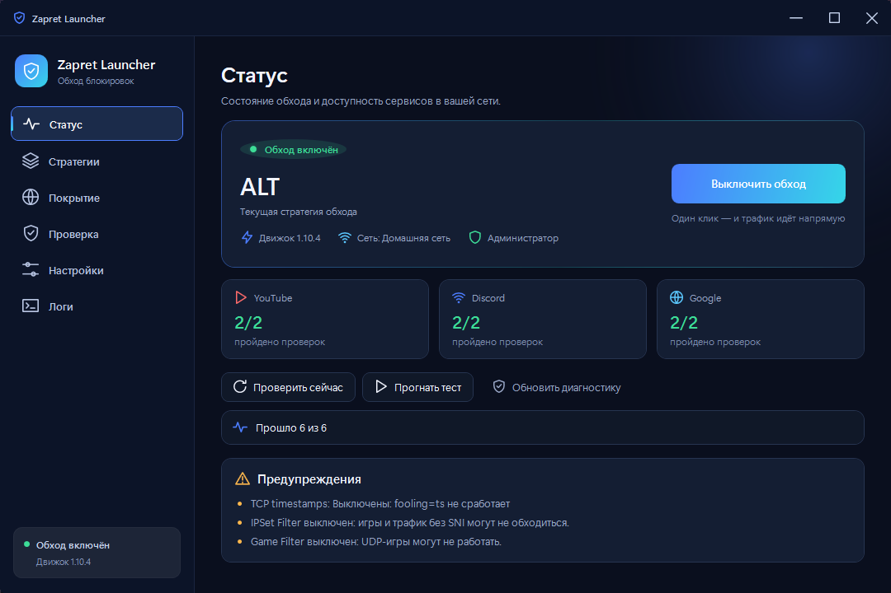

# Zapret Launcher

Windows-лаунчер для локального обхода DPI-блокировок YouTube, Discord и игр.
Прячет работу движка `zapret` за одним окном: подбор стратегии, покрытие,
диагностика, автозапуск и управление из трея.



## Возможности

- Одна кнопка для включения и выключения обхода.
- Автоподбор стратегии: тест встроенных профилей и выбор лучшего для текущей сети.
- Свои домены, исключения, IP-адреса и подсети.
- Режимы IPSet Filter и Game Filter для игр и трафика без SNI.
- Диагностика прав администратора, драйверов, служб, прокси и конфликтов.
- Обновление движка и списков без переустановки приложения.
- Автозапуск, старт свёрнутым, закрытие в трей.
- Тёмная и светлая темы, интерфейс на WPF.

## Стек

- .NET 9, WPF, MVVM (`CommunityToolkit.Mvvm`).
- Движок: [Flowseal/zapret-discord-youtube](https://github.com/Flowseal/zapret-discord-youtube)
  (`winws` + WinDivert), встроен в self-contained сборку.
- Тесты: xUnit.

## Сборка

Нужен .NET 9 SDK и Windows 10/11 x64.

```powershell
dotnet build ZapretLauncher.sln -c Release
dotnet test ZapretLauncher.sln -c Release
```

Публикация одним self-contained `.exe`:

```powershell
powershell -File tools/publish.ps1
```

Готовый файл появится в `dist/ZapretLauncher.exe`.

## Как это работает

При первом запуске приложение распаковывает встроенный движок в
`%LOCALAPPDATA%\ZapretLauncher\engine`, проверяет окружение и применяет
выбранную стратегию. Настройки, списки и логи хранятся в
`%LOCALAPPDATA%\ZapretLauncher`.

Для работы WinDivert приложению нужны права администратора. При закрытии окна
обход может продолжить работу в трее.

## Ограничения

- Только Windows 10/11 x64.
- Это не VPN и не прокси: обход работает на уровне DPI.
- WinDivert может вызывать ложные срабатывания антивируса. Это не вирус;
  добавляйте исключения только если понимаете риски.
- Используйте приложение только для законного доступа к контенту.
